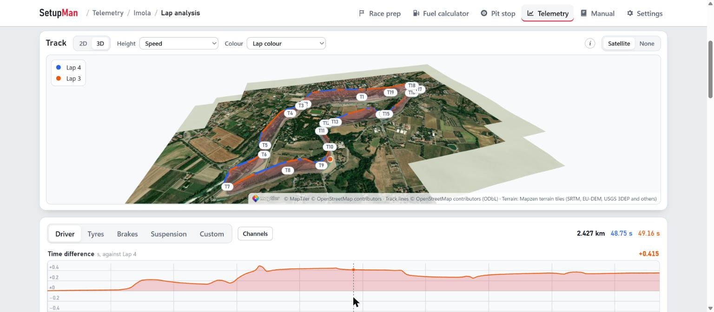
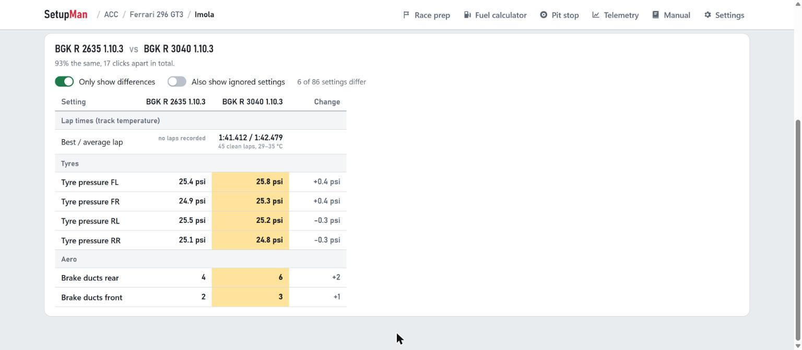
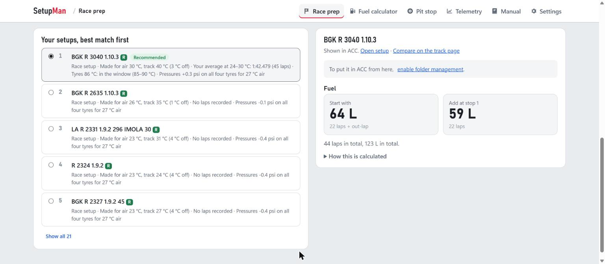
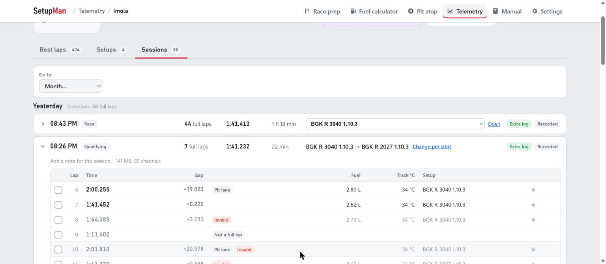

<p align="center"></p>

<h1 align="center">SetupMan</h1>

<p align="center"><b>Every version of every setup, the laps you drove with it,<br>and the fuel and tyre pressures for your next stint.</b></p>

<p align="center">Free setup manager and telemetry tool for Assetto Corsa Competizione, Assetto Corsa, AC EVO and AC Rally.</p>

<p align="center">
  <a href="https://github.com/LaurensVR3/SetupMan/releases/latest/download/SetupMan.exe"></a>
</p>

<p align="center">
  <a href="https://github.com/LaurensVR3/SetupMan/releases/latest"></a>
  
  
  <a href="https://github.com/LaurensVR3/SetupMan/actions/workflows/ci.yml"></a>
  <a href="LICENSE"></a>
</p>

<p align="center">
  <a href="docs/INSTALL.md"><b>Install guide</b></a> ·
  <a href="docs/COMPATIBILITY.md"><b>Supported games</b></a> ·
  <a href="docs/PRIVACY.md"><b>Privacy</b></a> ·
  <a href="docs/ROADMAP.md"><b>Roadmap</b></a> ·
  <a href="https://github.com/LaurensVR3/SetupMan/discussions"><b>Discussions</b></a>
</p>



## What it does

<table>
<tr>
<td width="50%" valign="top">
<br>
<b>Never lose a setup again.</b> Every change you save in the game is kept as a version, with a family tree
of where each setup came from. Compare any two setups and see only what differs.
</td>
<td width="50%" valign="top">
<br>
<b>Race prep in one click.</b> Pick car, track and session: your setups are ranked by tyre temperature and
lap time, with the pressure change for today's temperature and a complete fuel and pit stop plan.
</td>
</tr>
<tr>
<td width="50%" valign="top">
<br>
<b>Telemetry linked to your setups.</b> ACC's own MoTeC files, matched to the session and the setup you
drove. Compare up to four laps, turn by turn, and see where the time went.
</td>
<td width="50%" valign="top">
<b>On your second screen while you race.</b> Pit stop advice on a tablet or phone: fuel to add and tyre
pressures for the next stop, worked out from your last laps.<br><br>
<b>Your PC, your data.</b> Everything stays on your PC: no account, no tracking. SetupMan only reads your
setups folder until you allow more, and backs it up first.
</td>
</tr>
</table>

## Get started

1. **[Download `SetupMan.exe`](https://github.com/LaurensVR3/SetupMan/releases/latest/download/SetupMan.exe)**,
   put it in a folder of its own and double-click it.
2. Windows may warn that it doesn't know the program yet: **More info → Run anyway**
   ([why, and how to check the file](docs/INSTALL.md#the-windows-warnings)).
3. SetupMan opens in your browser and finds your installed games.

Upgrading, uninstalling and using a tablet: [installation guide](docs/INSTALL.md).
The Manual inside SetupMan (top bar → Manual) explains every feature.

> **Early version, looking for testers.** Assetto Corsa Competizione is tested on a sim rig and in online
> races. Assetto Corsa, AC EVO and AC Rally are built from real setup files and need players to try them:
> [your feedback](#feedback) moves them forward fastest. What works per game: [supported games](docs/COMPATIBILITY.md).

## All features

- Shows your setups per game, car and track, with readable names and brand logos.
- Finds identical and near-identical setups and compares them side by side.
- Keeps every version of every setup, shows where a setup came from (family tree with Q / R / endurance
  branches) and lets you add notes. Your existing setups get a *probable* history, which you can correct.
- Updates automatically when setups change, but not while you are driving.
- **Change values** of a setup as the game shows them, and save it as a new version or a new setup.
- **Fuel calculator** for races (stops, pit window) and qualifying, per car and track.
- **Session reports**: every practice, qualifying or race session on one page, with stints and every lap
  (time, fuel, temperatures, hot tyre pressures). Open one from a setup's Lap times tab.
- **Pit stop advice** during an ACC or AC session (top bar → Pit stop): fuel to add and tyre pressures for the next
  stop, from your last laps (targets 27.0 psi dry, 30.0 psi wet). Made for a second screen or tablet.
- **Records your laps** while ACC or AC runs: best and average lap, fuel per lap and track temperature per setup
  version. The setup you drive is recognised from what the car reports (in ACC: fuel, the pit
  strategy's tyre pressures, TC, ABS, engine map; in AC also the setup file the game opened last). When setups
  fit equally well, **Manual setup select** sets it with one click.
- **Naming standard**: suggested names per setup or for a whole game at once (with a preview), rename by
  hand, or apply it to new in-game saves automatically (opt-in). The track page shows each setup's game version.
- **Adjust for temperature**: proposes tyre pressure and brake duct changes, learned from your own setups.
- **Share** a setup as one file that a friend opens in their SetupMan (setup page → Share…).
- **Export and import** setups as ZIP files (track page), and **full SetupMan backups** of everything
  (Settings → Backups & bin), which you can download and restore, also on another PC.
- Optionally manages the game's setups folder so ACC only shows the setups you pick (see below).
- **Race prep**: pick the car, track, session and temperature; SetupMan ranks your setups (tyres in the
  window first, then lap time), suggests the pressure change for the day's temperature and plans the fuel,
  pit stops included (measured pit lane time + a planned standing time).
- **Telemetry** (ACC): SetupMan reads ACC's own MoTeC files and links every lap to its session and setup
  (per stint when you swap setups). Compare up to four laps along the distance: time difference, any
  channel, the track map with official turn numbers, tyres and brakes, and a table of time gained or lost
  per turn. An optional extra log adds what MoTeC lacks (car position, fuel, brake wear, slip).
- **3D track view**: every lap on its own driving line on the real, hilly track, with a wall showing a
  channel (e.g. speed) and the graph cursor as a marker. Sharp satellite photos with your own free MapTiler
  key, or government aerial photos you can keep for offline use at 13 tracks.


## Folder management

By default SetupMan only *reads* your setups folder. When you enable **Settings → Games → Folder management**:

1. SetupMan first creates a backup of the whole folder and verifies that every setup is stored in its library.
2. On a track page you select which setups the game lists (**Show only these in ACC**); the others are hidden
   from the game but stay stored in SetupMan, and can be shown again at any time (also older versions).
3. New setups you save in ACC are listed as "New setups saved in ACC", so you can keep or hide them.
4. Nothing changes while you are driving; changes wait until you stop.

**Settings → Backups & bin** lists your ACC setups folder backups. **Restore** puts the folder back exactly as it
was at that moment (every file, name and date); SetupMan creates a backup of the current state first, so a
restore can be undone too. These backups contain only the game folder, not SetupMan's own history and notes.

Every design decision is recorded in [`SetupMan Spec.md`](SetupMan%20Spec.md).

## Running SetupMan

The tray icon next to the clock: left-click opens SetupMan; right-click has **Start with Windows** and
**Stop SetupMan**. Closing the browser does not stop SetupMan.

Options (from a terminal):

```
SetupMan.exe --port 9000      use another port for this run (normally set in Settings → Network; default 8765)
SetupMan.exe --no-browser     don't open the browser (used by Start with Windows)
SetupMan.exe --no-tray        no tray icon; stop with Ctrl+C (for development)
```

All of SetupMan's data is in `%APPDATA%\SetupMan` (settings, the library with every setup version, backups,
the log `setupman.log`). What is stored and when SetupMan goes online: [Privacy and security](docs/PRIVACY.md).
ACC's own MoTeC files are only read, never changed, moved or deleted.

## How "similar" is calculated

Every setting counts as one field (each wheel separately). The score is the percentage of fields that are
identical. Shown but not scored:
- the car name and the track BoP type;
- telemetry laps, the selected tyre set, and ACC's own fuel-per-lap estimate;
- values the game calculates itself: static camber, linear toe and rod length.

Unused pit-strategy slots are ignored.

## Build from source

Requires Go (`winget install GoLang.Go`), nothing else. See [CONTRIBUTING.md](CONTRIBUTING.md) for building,
testing, the code layout and pull requests. Every release is built by GitHub from this source, with a SHA256
checksum next to the download.

## Feedback

SetupMan is tested on one sim rig so far, mostly with ACC. Reports from players make it better quickly,
especially for Assetto Corsa, AC EVO and AC Rally. The easiest way: in SetupMan, **Settings → About →
Feedback**. Each button opens a short form with your version filled in:

- **Report a problem**: something is wrong, missing or doesn't start;
- **A value differs from the game**: a number on the Setup tab doesn't match the game's setup screen;
- **Send a test report**: tick what worked with a game (about ten minutes of driving);
- **Suggest an idea**.

Or [open an issue](https://github.com/LaurensVR3/SetupMan/issues/new/choose) here directly. The log file helps
most: Settings → About → **Open log folder**, then drag `setupman.log` into the form. It lists what SetupMan
saw of your games and your setup names, nothing else personal.

Questions, or want to share how you use SetupMan? Join the [Discussions](https://github.com/LaurensVR3/SetupMan/discussions).

## Credits

- [Vue](https://vuejs.org), [Vue Router](https://router.vuejs.org) and [three.js](https://threejs.org) (MIT). Licences are in `internal/server/web/vendor`.
- 3D track view: race track lines © [OpenStreetMap](https://www.openstreetmap.org/copyright) contributors (ODbL);
  terrain from the open [Mapzen terrain tiles](https://registry.opendata.aws/terrain-tiles/) (SRTM, EU-DEM, USGS 3DEP and others);
  satellite photos from [MapTiler](https://www.maptiler.com) with your own key (loaded by your browser, never stored);
  offline aerial photos from PDOK (NL), Digitaal Vlaanderen and SPW Wallonie (BE), LVermGeo Rheinland-Pfalz (DE),
  basemap.at (AT), IGN (FR), PNOA / IGN (ES), GSI (JP) and USGS (US), each credited on the view as its licence asks.
- Official turn numbers: worked out from the circuit maps on [Wikimedia Commons](https://commons.wikimedia.org).
- Real setup values for every ACC car: the numbers from the open-source [Race Element](https://github.com/RiddleTime/Race-Element) project (GPL-3; only its data is used, not its code).
- [modernc.org/sqlite](https://gitlab.com/cznic/sqlite) (pure Go SQLite), [fyne.io/systray](https://github.com/fyne-io/systray) and [golang.org/x/sys](https://pkg.go.dev/golang.org/x/sys).
- Brand logos are downloaded from [Wikimedia Commons](https://commons.wikimedia.org) when SetupMan runs. They are trademarks of
  their owners and are only used to identify the cars.
